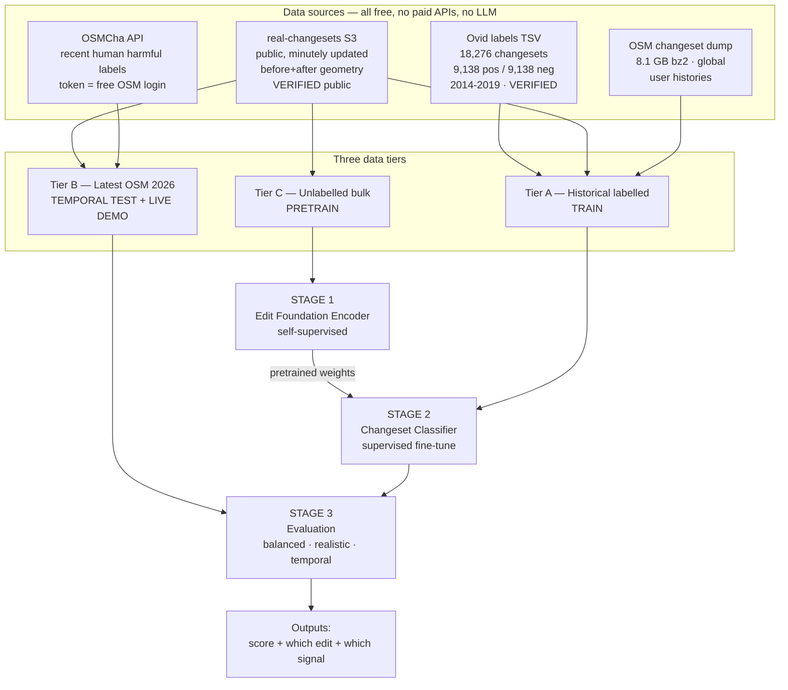
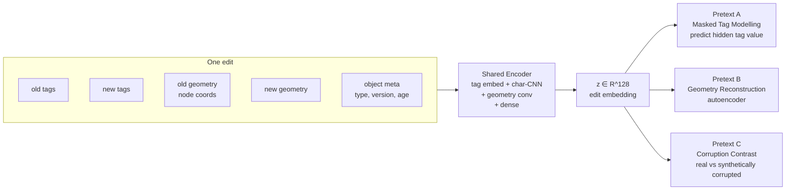
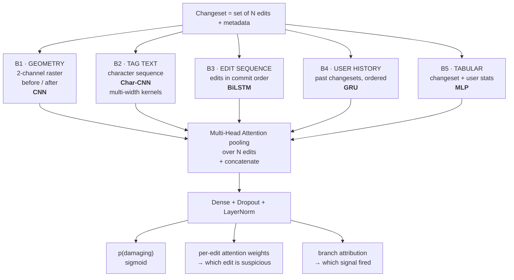
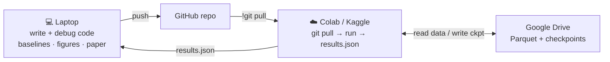

# MapGuard — Self-Supervised, Geometry-Aware Detection of Damaging Edits in OpenStreetMap

**Course:** Deep Learning (702AI0C008) — Mini Project
**Team size:** 4
**Status:** Architecture locked, pending Gate 0 verification (§8)
**Last updated:** 2026-09-04

---

## 1. Problem

OpenStreetMap is editable by anyone with no pre-approval. ~50,000 changesets land per day. Some are damaging:

| Class | Example | Detectable by |
|---|---|---|
| Geometry vandalism | Fake town drawn in the ocean; a road node dragged 400 km | shape / displacement |
| Semantic vandalism | Offensive or gibberish text written into a `name` tag | text content |
| Destructive edits | Large fraction of a city deleted | scale + operation mix |
| Careless newbie damage | One node dragged, road stretches across a country | geometry + user history |
| Broken imports | 10,000 duplicate buildings | changeset size + repetition |

Consumers of this data: Apple Maps, Meta, Amazon Logistics, every open routing engine, and humanitarian mapping (HOT / Red Cross disaster response). A bad edit becomes a broken route.

**Current defence is mostly manual.** Volunteers read changesets by hand in OSMCha, assisted by rule-based flags with poor precision.

---

## 2. How industry actually solves this today

This is the part that shapes our architecture. All of it is documented publicly.

| Organisation | System | Approach | What we take from it |
|---|---|---|---|
| **Meta** | Daylight Map Distribution (2020–Nov 2024) | **User embeddings** — word2vec skip-gram over user edit sequences, 32-dim, 1.6M users. Shipped to production. Released the first OSM vandalism corpus (1M edits, `name` attribute). CIKM '21. | Users are the strongest single signal. We modernise `user2vec` into a learned sequence encoder |
| **Overture Maps** | Successor to Daylight | Monthly planet snapshot → checks for coastline integrity, broken relations, vandalism → **~4 weeks to remediate** | Production today is **monthly batch**. Near-real-time is an open gap |
| **Wikimedia** | Revert Risk (replacing ORES) | Trained **solely on historical trace data** — revert history as ground truth, no hand labels. Served on Lift Wing. Their LLM variant is too slow (~1 s median) so lightweight models still win | Validates our label strategy *and* our no-LLM design |
| **Uber** | CatchME | GPS-trace-derived map error detection; separate NLP/DL model over support tickets | Multi-signal fusion; errors are inferred, not reported |
| **Stripe** | Payments Foundation Model (2025) | Transformer **self-supervised** on tens of billions of transactions → dense per-transaction embeddings → fine-tuned heads. Card-testing fraud recall **59% → 97%** with no FP increase | The single closest analogue. Pretrain on unlabelled events, fine-tune on scarce labels — exactly our Stage 1 → Stage 2 |

**Synthesis:** the modern pattern for abuse detection is *self-supervised foundation encoder over event sequences, fine-tuned per task, with entity (user) embeddings as a first-class input.* Nobody has applied that pattern to OSM. That is our project.

### Academic state of the art

| Work | Year | Method | Result |
|---|---|---|---|
| OSMPatrol | 2012 | hand-tuned rules | F1 69.15 |
| WDVD (Wikidata) | 2016 | random forest, text features | F1 72.20 |
| OSMWatchman | 2020 | random forest, **buildings only** | F1 74.01 |
| GloVe+CNN | community | text embeddings + CNN | F1 76.96 |
| Meta user embeddings | 2021 | word2vec user vectors + classifier | production |
| **Ovid** (SOTA) | 2021/22 | multi-head attention over edits | **F1 81.66** |

All F1 figures above are on a **50/50 balanced test set**. Real-world prevalence is far below 1%, so none of these numbers describe operational performance.

---

## 3. Verified gaps

Read directly from the Ovid paper's feature tables, not its abstract. Ovid uses:

- **Changeset:** counts of creates/modifies/deletes/edits; **bounding box only**; editor app, comment length, `imagery_used`
- **User:** aggregate counts of past contributions; account age; active weeks; top-12 keys used
- **Edit:** object type, version no., #previous authors, #tags, #valid tags, edit op, time since previous version, and `name changed` **as a boolean**

| # | Gap | Evidence |
|---|---|---|
| **G1** | **No real geometry.** Bounding box only — no shape, no displacement, no area change, no topology | Ovid §3.1.1. Ovid itself notes the one geometry-aware prior work (OSMWatchman) *"is limited to the building domain"* |
| **G2** | **No tag content.** `name changed` is a boolean; what was actually typed is never read | Ovid §3.1.3 |
| **G3** | **User history is aggregates, not a sequence.** Counts and dates, no temporal order | Ovid §3.1.2 |
| **G4** | **Large changesets are gutted.** Above threshold `th_e,max` the edit vector is **zeroed**; model falls back to user+changeset features. Mass vandalism and broken imports *are* large changesets | Ovid §3.2 |
| **G5** | **Balanced-set evaluation.** Negatives randomly downsampled to match positives | Ovid §4.1 |
| **G6** | **No temporal generalisation test.** Trained and tested on 2014–2019; never evaluated on later data | whole paper |

### Independent confirmation

The 2024 survey *ML Updates for OpenStreetMap: Analysis of Research Gaps and Future Directions* (arXiv 2407.03365) independently names as open gaps:

- *"leveraging unlabeled OSM data for model pre-training, despite its abundance"* → **our Stage 1**
- geometry beyond simple point/polygon classification → **our G1**
- *"inconsistent benchmarking practices"* → **our G5/G6**
- industry/academia gap on *"real-time processing"* → **our Tier B live stream**

Our contributions are literally three of the gaps a 2024 survey asked for. This section is the lit-review deliverable (2 marks).

---

## 4. The idea

> **Teach a network what normal map editing looks like — for free, from millions of unlabelled edits — then fine-tune it to spot the abnormal, and give it the one signal every prior model discards: the actual shape of what changed.**

Two stages, following the Stripe pattern:

**Stage 1 — Edit Foundation Encoder (self-supervised, no labels).** Learns a 128-d representation of "a normal OSM edit" from unlimited unlabelled data via three pretext tasks.

**Stage 2 — Changeset classifier (supervised).** Loads the pretrained encoder, adds geometry/text/sequence/user branches, fine-tunes on the 18,276 labelled changesets.

Why fusing beats either alone: self-supervised tag modelling on its own is a solved, boring task. As pretraining it becomes the answer to the field's stated #1 blocker — Ovid's own abstract names *"the lack of annotated data"* as the core difficulty.

---

## 5. Architecture

### 5.1 System overview



### 5.2 Stage 1 — Edit Foundation Encoder

Input is one **edit** (one object changed), not a whole changeset.



**Pretext A — Masked tag modelling.** Hide one tag value, predict it from the remaining tags plus object context. Teaches co-occurrence: `highway=residential` implies a street-like `name` and plausible `maxspeed`; `place=city` does not belong in open ocean.

**Pretext B — Geometry reconstruction.** Autoencode the polyline/polygon into `z` and rebuild it. Reconstruction error is itself an anomaly score at inference.

**Pretext C — Corruption contrast.** We synthesise damage — displace geometry, scramble a name, ×100 the area, delete a chunk — and train the encoder to separate real from corrupted. Free supervision, unlimited volume. This is the highest-value pretext task because the corruptions are chosen to mimic real vandalism modes.

Loss: `L = L_mask + λ₁·L_recon + λ₂·L_contrast`. The λ weights are an ablation.

### 5.3 Stage 2 — Changeset classifier

A changeset is a **variable-length set of edits**. Five branches, attention fusion.



| Branch | Closes gap | Course concept | Unit |
|---|---|---|---|
| B1 Geometry CNN | **G1** | convolution, pooling, striding, param counting | U4 |
| B2 Char-CNN | **G2** | 1-D convolution; multi-width parallel kernels = Inception idea | U4 |
| B3 Edit BiLSTM | **G4** | LSTM, BPTT | U5 |
| B4 User GRU | **G3** | GRU; modernises Meta's `user2vec` | U5 |
| B5 Tabular MLP | baseline parity | perceptron → MLP → backprop | U2 |
| Attention fusion | reimplements Ovid | beyond classroom | — |
| Stage 1 → Stage 2 | label scarcity | **transfer learning** (lab expt 8, off-image) | U4 |

### 5.4 Three outputs, not one

Ovid emits a score. A human reviewer needs to know *where to look*:

1. `p(damaging)` — calibrated probability
2. **which edit** inside the changeset is most suspicious — read off attention weights
3. **which signal fired** — geometry / text / user / scale

Output 2 and 3 cost nothing extra and are a genuine usability contribution.

---

## 6. Deep learning concepts — syllabus mapping

| Unit | Concept | Where used |
|---|---|---|
| **U2** | Perceptron → MLP → feedforward | B5 tabular branch |
| **U2** | Backpropagation, BPTT | end-to-end; BPTT through B3/B4 |
| **U2** | Activation functions | ReLU trunk, sigmoid output, tanh in LSTM gates. Ablation: ReLU / LeakyReLU / GELU |
| **U2** | Loss functions | BCE → **focal loss** (imbalance) |
| **U3** | SGD, mini-batch, momentum, Nesterov, AdaGrad, RMSProp, Adam | direct reuse of **lab expt 6** protocol → real results table |
| **U3** | L1/L2, dropout, early stopping | early stopping on val **PR-AUC**, not accuracy |
| **U4** | Convolution, pooling, striding, param counting | B1 (2-D), B2 (1-D) |
| **U4** | Inception / ResNet ideas | multi-width parallel kernels in B2; residual connections when stacking |
| **U4** | **Transfer learning** | lab expt 8 procedure, applied off-image: pretrain → freeze → fine-tune |
| **U5** | Vanilla RNN, vanishing gradients | we **train one deliberately**, plot gradient-norm collapse over 200-step user histories, then justify LSTM. Strong report section |
| **U5** | **LSTM / GRU** | B3 and B4; LSTM vs GRU vs BiLSTM comparison |

**Beyond classroom:** multi-head attention · self-supervised pretraining · embedding layers · multimodal fusion · focal loss · PR-AUC / precision@k · model calibration.

Every unit genuinely used. Nothing name-dropped.

---

## 7. Data plan

### Tier A — Historical labelled (training)

| Item | Detail | Status |
|---|---|---|
| `ovid_labels.tsv` | 18,276 rows, 9,138 pos / 9,138 neg, changeset IDs 19,739,784–79,067,468 | ✅ **downloaded and inspected** |
| Changeset **contents** | ~~`real-changesets` S3~~ → **OSM API** `/api/0.6/changeset/<id>/download` | ✅ **verified 3/3** (Gate 0 killed the S3 route for this era — see §8) |
| Previous object versions | OSM API `/api/0.6/<type>/<id>/<version-1>` | ✅ verified 2/2; ways return `<nd>` refs without coordinates |
| User histories | OSM changeset dump, 8.1 GB bz2, streamed | ✅ public, no login |

**Verified `real-changesets` record schema** — each element carries an `old` block:

```json
{"elements": [{
  "id": "494555506", "version": "6", "changeset": "147186571",
  "uid": "15324596", "user": "dmfr", "timestamp": "...",
  "old": {
    "version": "5", "action": "modify", "type": "way",
    "tags": {"landuse": "landfill", "name": "..."},
    "nodes": [{"ref": "4863084239", "lat": "38.9390456", "lon": "-9.2914563"}, ...]
  }
}]}
```

Before **and** after tags, plus before/after node coordinates — the geometry branch handed to us directly, with no history PBF and no geometry reconstruction.

**But only inside the bucket's window.** Gate 0 pinned that window to **~147M–164M (Feb 2024 – Mar 2025)**; the 2014–2019 label range returns 404 for every probe. So this shortcut serves Corpus B, not Corpus A. See §8.3.

### Corpus B — Modern (Feb 2024 – Mar 2025)

The bucket's usable window, ~17M changesets:

- **Full before/after tags and geometry**, free and in bulk — the only place branch **B1** can run at full strength
- Labels to be built: OSMCha `harmful` (human-reviewed, needs a free token) + revert mining from the changeset dump
- **Uses:** (i) the geometry branch; (ii) **cross-corpus generalisation** — train on Corpus A, evaluate on Corpus B, closing **G6**; (iii) demo for phase-2 eval

Expect a measurable drop across corpora. That drop *is* the finding — OSM's editor mix, tag conventions and vandalism styles have all shifted since 2019.

> **Note on "latest OSM data".** The bucket stops at ~Mar 2025 despite the AWS registry advertising minutely updates. Genuinely current data (to changeset 188,495,159, 2026-09-03) is reachable only through the OSM API or Overpass, one changeset at a time. Fine for a live demo; not for bulk training.

### Corpus C — Unlabelled (pretraining)

Bulk `real-changesets` JSONs from the same window, no labels. Target ~500k–2M edits. Free and effectively unlimited within Feb 2024 – Mar 2025.

---

## 8. Gate 0 — RESULT: FAILED, and what it changed

Run 2026-09-04. Scripts and raw output are in the repo: `scripts/gate0_coverage.py`, `gate0b_fallback.py`, `gate0c_bounds.py` → `results/*.json`.

### 8.1 Gate 0a — bucket coverage of Ovid labels: **FAIL**

Probed 140 labelled changeset IDs, stratified across the full 19.7M–79.1M range and both classes.

```
 19,739,784 .. 26,264,610    0/14   0.0%
 26,766,789 .. 33,057,653    0/14   0.0%
 ... every stratum ...       0/14   0.0%
 70,585,049 .. 77,858,897    0/14   0.0%
--------------------------------------------
 overall                    0/140   0.0%     status codes: {404: 140}
```

Not a partial cutoff — **zero coverage, uniform across every stratum.** `real-changesets` simply does not hold 2014–2019 changesets.

### 8.2 Gate 0b/0c — the replacement, verified

| Question | Result |
|---|---|
| Does `GET /api/0.6/changeset/<id>/download` work on old changesets? | ✅ **3/3**, HTTP 200, 1.4–2.9 KB, **~0.2 s** each. Contains full tag diffs, operations, object versions, and inline `lat`/`lon` for nodes |
| Does `GET /api/0.6/<type>/<id>/<version-1>` return the previous state? | ✅ **2/2**, HTTP 200, ~0.8 s. Returns tags — **but ways return `<nd>` refs with no coordinates** |
| Where does the bucket actually cover? | **~147M – 164M**, i.e. **Feb 2024 → ~Mar 2025**. Sharp cutoff between 164M and 165M |
| Current max changeset ID | **188,495,159** (2026-09-03) |

Two consequences that change the plan:

1. **The AWS registry's "minutely updated" claim is stale.** The bucket stopped being fed around early 2025. "Latest OSM data" via the bucket means up to ~March 2025, not today.
2. **Historical way geometry is expensive via the API.** A way's previous version gives node *references*, not coordinates; resolving them costs one extra call per node. For nodes, `lat`/`lon` are inline and free.

### 8.3 What this forces — and why the result is better than the plan it replaced

The geometry branch cannot run at full strength on the Ovid-era labels, and the bucket cannot serve those labels at all. So the corpus splits in two, and each half does the job it is actually good at:

| | **Corpus A — Ovid-era** | **Corpus B — Modern** |
|---|---|---|
| Period | 2014–2019 | Feb 2024 – Mar 2025 |
| Source | OSM API, per changeset | `real-changesets` S3, bulk |
| Labels | ✅ 18,276, published, **downloaded** | ⚠️ to be built — OSMCha `harmful` + revert mining |
| Tags, ops, versions | ✅ full | ✅ full |
| Node geometry | ✅ inline | ✅ inline |
| **Way/relation geometry** | ✗ expensive (N calls/way) | ✅ **free, before + after** |
| Cost | ~5 h fetch, cached, resumable | bulk download |
| **Role** | comparability with published SOTA; branches **B2, B3, B4, B5** | the **B1 geometry branch** at full strength; **G6** temporal test |

This is a stronger design than the single-corpus plan. The temporal contribution (**G6**) sharpens from "test on later data" into a genuine cross-corpus generalisation study, and **building a modern labelled benchmark becomes a contribution in its own right** — precisely the "inconsistent benchmarking practices" gap named by arXiv 2407.03365.

**Cost of the failure: ~20 person-hours**, as budgeted in the original fallback. Nothing is blocked.

### 8.4 Remaining open item

Corpus B needs labels. Two independent routes, either sufficient:

- **OSMCha `harmful` flag** — human-reviewed, cleanest. Needs a free token from your OSMCha user page after OSM login. **Action on you.**
- **Revert mining** — parse the 8.1 GB changeset dump for revert comments in the 2024–25 window. No account needed; runs on Colab.

Do both; use OSMCha as the high-precision set and revert mining for volume.

---

## 9. Compute plan — sized to your hardware

### Measured local machine

```
CPU   : Intel i5-8265U @ 1.60 GHz — 4 cores / 8 threads (2018 mobile, thermally limited)
RAM   : 7.82 GB total — 0.77 GB free at measurement
Disk  : C: 475.6 GB total, 72 GB free
GPU   : integrated — no CUDA
```

### ⚠️ Two hard constraints and one trap

1. **No CUDA.** All GPU work goes to Colab or Kaggle. Non-negotiable.
2. **0.77 GB free RAM.** Anything that "loads a dataframe" locally will thrash. Heavy data work goes to the cloud, where Colab gives 12.7 GB and Kaggle gives ~29 GB.
3. **🚩 TRAP — the project folder is inside OneDrive.**
   `C:\Users\Ayush Manoj Garg\OneDrive\Desktop\mpstme\...`
   Writing GBs of data there makes OneDrive attempt to sync all of it. This *will* wedge the machine.
   **Rule: all data goes in `C:\osm-data\` (outside OneDrive). Only code, figures and documents live in the project folder.**

### Where each stage runs

| Stage | Where | Why |
|---|---|---|
| Fetch 18k changeset JSONs | **Colab** | fast network; keeps GB off the laptop |
| Parse JSON → Parquet features | **Colab** (12.7 GB RAM) | laptop has 0.77 GB free |
| Feature store | **Google Drive** | persistent across sessions |
| Changeset dump → user histories | **Colab** | bz2 decompression is CPU-heavy and single-threaded |
| Baselines (LogReg, XGBoost) | **Laptop** ok | small; DuckDB keeps RAM flat |
| **Stage 1 pretraining** | **Kaggle** (P100 / 2×T4) | longest job; 30 GPU-h/week, explicit quota |
| **Stage 2 training** | **Colab T4** | fast iteration loop |
| Ablation grid (~40 runs) | **Kaggle** | batch overnight |
| Figures, maps, paper | **Laptop** | light |

### Kaggle vs Colab

| | Colab free | Kaggle free |
|---|---|---|
| GPU | T4 | P100 or 2×T4 |
| Weekly quota | 15–30 h, **unstated** | ~30 h, **explicit** |
| RAM | 12.7 GB | ~29 GB |
| Disk | ~110 GB ephemeral | 20 GB **persistent** |
| Session | 12 h, idle-kill ~90 min | 12 h |

**Use both.** Colab for iteration (Drive mount, better UX), Kaggle for long/batch runs.

### Working loop



**Rules that keep this loop tight:**
- Notebooks stay **thin** — `git pull`, `pip install -r requirements.txt`, `import` from `.py` modules. No 2000-line cells, so edits are small diffs
- **Checkpoint to Drive every epoch.** Sessions die at 12 h / 90 min idle; every run must be resumable
- Featurised Parquet lives on Drive, uploaded once, never re-downloaded
- Metrics → `results.json`, one small file back, not screenfuls of stdout
- Everything I can run locally, I run and debug myself — no courier work. Only pretraining and the ablation grid need you in the loop

---

## 10. Tools

| Layer | Tool | Why |
|---|---|---|
| Language | Python 3.11 | — |
| **Out-of-core SQL** | **DuckDB** | queries Parquet larger than RAM. The key tool for an 8 GB machine |
| Dataframes | **Polars** (+ pandas where needed) | far lower memory than pandas |
| Columnar IO | PyArrow / Parquet | compressed, columnar, range-readable |
| S3 access | `requests` / `boto3` `--no-sign-request` | bucket is public |
| OSM parsing | `lxml.etree.iterparse`, `bz2` streaming | constant memory over the 8.1 GB dump |
| Geometry | Shapely, GeoPandas, pyproj | area/length/displacement features |
| **DL framework** | **Keras 3 (TF backend)** | course labs are TF/Keras; functional API handles multi-input cleanly. *PyTorch is the alternative if the team prefers it — decide once, in week 1* |
| Classical baselines | scikit-learn, XGBoost | LogReg / RF / GBDT reference points |
| Experiment tracking | Weights & Biases (free) | ablation grid is unmanageable in spreadsheets |
| Maps / viz | matplotlib, seaborn, Folium, contextily | figures + demo |
| Paper | LaTeX on Overleaf, IEEE conference template | plagiarism-checked deliverable |
| Repo | GitHub (private) | 4-way collaboration + Colab sync |

**No paid APIs. No LLM anywhere in the pipeline.** Consistent with the deterministic ethos of the prior stale-POI work, and matched to Wikimedia's finding that LLM-based revert-risk is too slow for production.

---

## 11. Evaluation protocol

The methodological contribution. Four regimes:

| Regime | Setup | Purpose | Closes |
|---|---|---|---|
| **R1 Balanced** | 9,138 / 9,138, user-disjoint 70/10/20 | apples-to-apples with Ovid's F1 81.66 | — |
| **R2 Realistic prevalence** | negatives upsampled to 1:100, 1:1000 | operational truth. **Report PR-AUC and precision@k, not F1** | **G5** |
| **R3 Temporal holdout** | train ≤2019, test on 2026 | drift. Nobody has published this | **G6** |
| **R4 Label efficiency** | fine-tune on 10/25/50/100% of labels | does pretraining actually help? | core claim |

**R4 produces the single most convincing figure in the paper:** pretrained vs from-scratch across label budgets. If the pretrained curve sits above the scratch curve — especially at 10% — the whole thesis is demonstrated in one plot.

### Ablation grid

| Config | B1 geom | B2 text | B3 edit-seq | B4 user-seq | B5 tab | Stage-1 pretrain |
|---|---|---|---|---|---|---|
| Ovid-repro | ✗ | ✗ | ✗ | ✗ | ✓ | ✗ |
| +geometry | ✓ | ✗ | ✗ | ✗ | ✓ | ✗ |
| +text | ✗ | ✓ | ✗ | ✗ | ✓ | ✗ |
| +sequences | ✗ | ✗ | ✓ | ✓ | ✓ | ✗ |
| Full, scratch | ✓ | ✓ | ✓ | ✓ | ✓ | ✗ |
| **Full, pretrained** | ✓ | ✓ | ✓ | ✓ | ✓ | ✓ |

Plus a **per-vandalism-type breakdown** — geometric vs semantic vs destructive. This matters: if geometry only helps the geometric subclass, that is a precise and useful finding rather than a null result.

### Expected results — stated in advance

| Regime | Expectation | Confidence |
|---|---|---|
| R1 balanced | **+2 to +6 F1** over Ovid's 81.66 | medium — could be +1 |
| R2 realistic | F1 collapses for **everyone** to ~0.2–0.4; PR-AUC becomes the real metric | high that it collapses; the number is the finding |
| R3 temporal | measurable drop on 2026 data | high |
| R4 label efficiency | pretrained above scratch, gap widest at 10% | medium-high — standard SSL result |

### Failure modes — and why neither sinks the project

- **Geometry adds little.** Plausible if most vandalism is tag-only. Finding becomes *"geometry helps only the geometric subclass"*, supported by the per-type breakdown. Still publishable.
- **Pretraining doesn't help.** Would mean 18k labels is already sufficient. Finding: *"label scarcity is not the bottleneck — feature coverage is."* That contradicts the field's stated assumption, including Ovid's own abstract. Also publishable.

**No outcome leaves us empty-handed.** That is deliberate.

---

## 12. Risk register

| Risk | Severity | Mitigation |
|---|---|---|
| ~~Gate 0 fails~~ | ~~High~~ | ✅ **Resolved — it did fail.** Two-corpus design adopted, +20 person-hours, §8 |
| Corpus B labels unobtainable | **Medium** | Two independent routes (OSMCha, revert mining); either alone suffices. If both fail, Corpus B still serves pretraining (C) and the geometry branch degrades to Corpus A node-only |
| ~~OneDrive syncs GBs of data~~ | ~~High~~ | ✅ **Resolved** — project moved to `C:\AyushGarg\projects\personal\osm_mapguard`, outside OneDrive |
| OSM API throttling during the 18k fetch | Medium | 1 req/s, resumable disk cache, back off on HTTP 509, split across 4 machines |
| Laptop RAM exhaustion | **High** | DuckDB + Polars + streaming; heavy work on Colab/Kaggle |
| Label noise — a revert ≠ always vandalism | Medium | Inherited from Ovid; identical protocol keeps comparison fair. Wikimedia's production model uses the same trace-based labelling. Limitations paragraph |
| Colab session death mid-run | Medium | Checkpoint to Drive every epoch; all runs resumable |
| Class imbalance | Medium | It *is* the contribution — focal loss, PR-AUC, threshold analysis |
| Scope creep from two fused ideas | Medium | Stage 1 is **ablatable**. If it fails, Stage 2 still stands as a complete project |
| OSMCha token / OSM account | Low | Free, instant. Needed for Tier B only |
| 4-way coordination | Medium | Workstream split in §13; one owner per branch |

---

## 13. Phasing and workstreams

Aligned to the course calendar: **topic approval end of week 3 · phase-1 eval week 7 · phase-2 eval week 14/15.**

| Phase | Weeks | Deliverable |
|---|---|---|
| **P0 Setup** | 1 | Gate 0 result, repo, OSM + OSMCha accounts, framework decision, data dirs |
| **P1 Baseline** | 2–7 | Tier A pipeline, Ovid reproduction, B2+B4+B5 branches, R1+R2 results → **phase-1 eval** |
| **P2 Full system** | 8–14 | Stage 1 pretraining, B1 geometry branch, Tier B temporal test, full ablation grid, demo → **phase-2 eval** |
| **P3 Paper** | 12–15 | Draft, figures, plagiarism check, submission |

### Compressed 3-week variant

If the whole thing must ship in 3 weeks (~145 person-hours) rather than staged: drop **B1 geometry rasters**, keep node-displacement features only; run **one** pretext task instead of three; static figures instead of an interactive demo. Contributions **G2, G3, G4, G5** survive intact; **G1** becomes partial. Still a real paper — just narrower.

### Workstream split (4 people, one owner each)

| Owner | Workstream | Artefacts |
|---|---|---|
| **WS1** | Data pipeline | Gate 0, S3 fetcher, JSON→Parquet, DuckDB feature store, user histories |
| **WS2** | Baselines + evaluation harness | LogReg/XGBoost, Ovid reproduction, R1–R4 harness, metrics, calibration |
| **WS3** | Model — Stage 2 branches | B1–B5, attention fusion, training loop, W&B |
| **WS4** | Model — Stage 1 + demo | pretext tasks, corruption generator, pretraining runs, Folium demo, figures |

All four co-author the paper. WS1 must finish first — it gates everyone, so WS2/3/4 build against a small mock Parquet in week 1 rather than waiting.

---

## 14. Paper

> **Geometry-Aware, Self-Supervised Detection of Damaging Edits in OpenStreetMap**

Claimed contributions, each checkable against §3:

1. First deep model to use **actual edit geometry** for general OSM vandalism (prior geometry work is buildings-only random forest)
2. First application of **self-supervised pretraining** to OSM quality assurance — named as an open gap by arXiv 2407.03365 (2024)
3. First evaluation at **realistic prevalence** and under **temporal shift**
4. **Explainable output** — which edit, which signal — for the human review queue

Positioned as: *the Stripe/Wikimedia production pattern (self-supervised sequence foundation model + trace-derived labels), applied to a domain where production systems still run monthly batch checks.*

---

## 15. Decisions

| # | Decision | Status |
|---|---|---|
| 1 | Gate 0 | ✅ **run — FAILED.** Two-corpus design adopted, §8 |
| 2 | Keras 3 vs PyTorch | ✅ **Keras 3 on TensorFlow.** Course-aligned; multi-input functional API suffices |
| 3 | Timeline | ✅ **Staged** — P1 → week 7, P2 → week 14, per §13 |
| 4 | Region scope | ✅ **Global.** Both corpora are keyed by changeset ID, not geography. The per-region label-scarcity risk never applies |
| 5 | OSM account + OSMCha token | ⏳ **on you** — free, instant. Gates Corpus B labels only |
| 6 | Corpus B label route | ⏳ OSMCha `harmful` **and** revert mining; use both |

### ⚠️ Environment note — local Python is 3.14

The machine has Python 3.14.4. **TensorFlow does not support 3.14.** Local work therefore needs a separate 3.12 virtual environment:

```
py -3.12 -m venv .venv
.venv\Scripts\activate
pip install -r requirements.txt
```

If 3.12 is not installed, install it — or skip local model work entirely and use Colab/Kaggle, which ship supported versions. Local Python is only needed for baselines and figures; nothing on the critical path depends on it.

---

## References

- Tempelmeier & Demidova. *Ovid: A Machine Learning Approach for Automated Vandalism Detection in OpenStreetMap.* SIGSPATIAL 2021. arXiv:2203.11087
- Tempelmeier & Demidova. *Attention-Based Vandalism Detection in OpenStreetMap.* WWW 2022. arXiv:2201.10406
- Li, Anderson & Niu. *Vandalism Detection in OpenStreetMap via User Embeddings.* CIKM 2021
- *ML Updates for OpenStreetMap: Analysis of Research Gaps and Future Directions.* arXiv:2407.03365, 2024
- Neis, Goetz & Zipf. *Towards Automatic Vandalism Detection in OpenStreetMap.* ISPRS IJGI 2012
- Truong, Touya & de Runz. *OSMWatchman: Learning How to Detect Vandalized Contributions in OSM Using a Random Forest Classifier.* ISPRS IJGI 2020
- Heindorf et al. *Vandalism Detection in Wikidata.* CIKM 2016
- Vaswani et al. *Attention Is All You Need.* NIPS 2017
- Stripe. *Payments Foundation Model.* Stripe Sessions 2025
- Wikimedia. *Language-agnostic Revert Risk model.* Meta-Wiki
- Overture Maps Foundation — data quality and validation documentation
- Registry of Open Data on AWS — `real-changesets`
